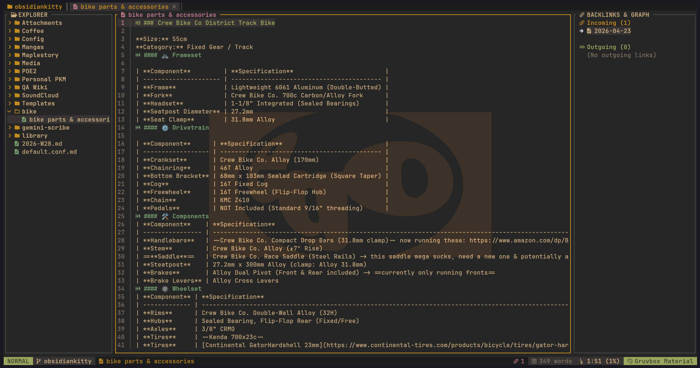
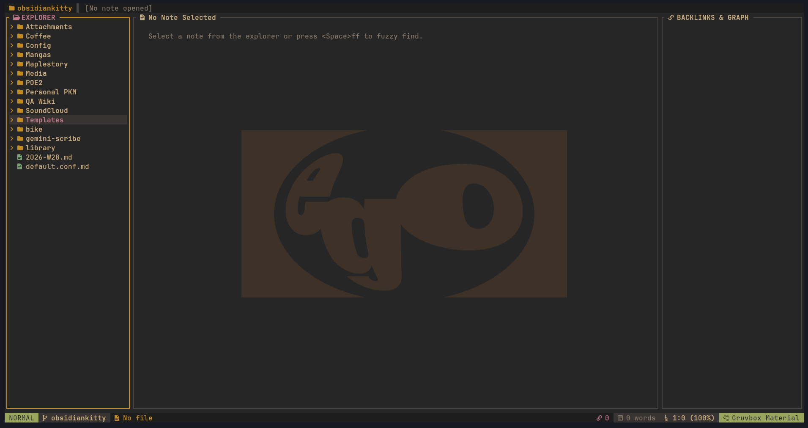
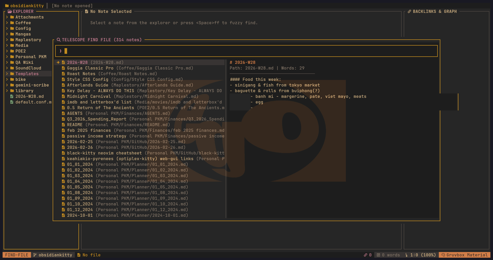
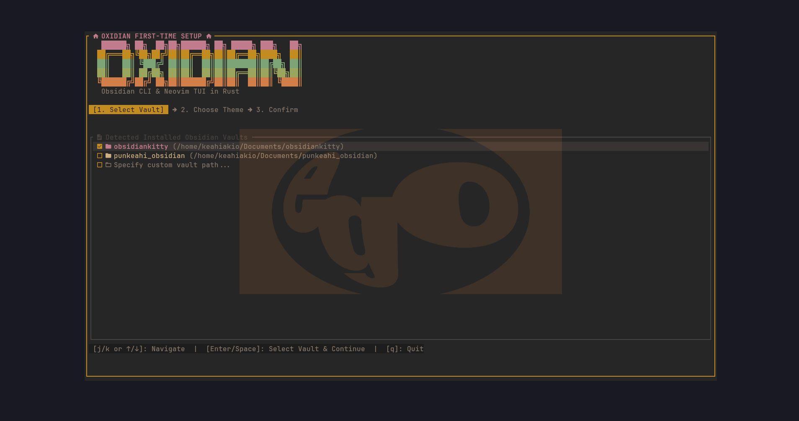
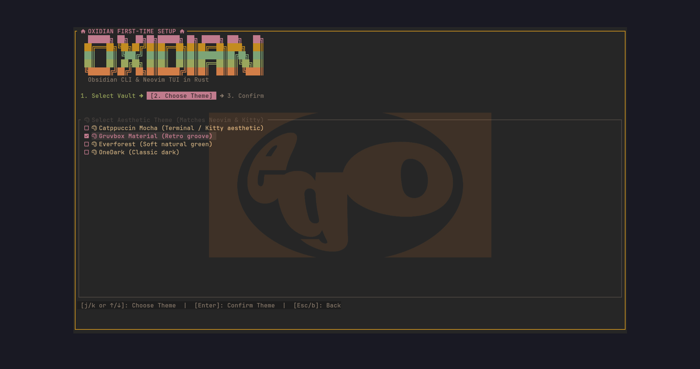

# (｡•̀ᴗ-)✧ oxidian

```text
   ██████╗ ██╗  ██╗██╗██████╗ ██╗ █████╗ ███╗   ██╗
  ██╔═══██╗╚██╗██╔╝██║██╔══██╗██║██╔══██╗████╗  ██║
  ██║   ██║ ╚███╔╝ ██║██║  ██║██║███████║██╔██╗ ██║
  ██║   ██║ ██╔██╗ ██║██║  ██║██║██╔══██║██║╚██╗██║
  ╚██████╔╝██╔╝ ██╗██║██████╔╝██║██║  ██║██║ ╚████║
   ╚═════╝ ╚═╝  ╚═╝╚═╝╚═════╝ ╚═╝╚═╝  ╚═╝╚═╝  ╚═══╝
         Obsidian CLI & Neovim TUI in Rust
```

> **A blazing-fast CLI & Neovim-aesthetic TUI for Obsidian vaults, built in Rust with Ratatui.**  
> *(づ｡◕‿‿◕｡)づ All the power of your Obsidian graph with zero Electron overhead.*

`oxidian` gives you an instant, lightweight terminal interface for your Obsidian knowledge base with the exact look, feel, and vim muscle memory of your Neovim environment.

---

## (•̀ᴗ•́)و Features

- **(｡♥‿♥｡) First-Time Onboarding Wizard**: On first run, `oxidian` auto-scans your system, detects existing vaults (`work_vault`, `personal_notes`), and lets you interactively configure your default vault and theme.
- **(=^･ω･^=) Zero-Config Vault Discovery**: Automatically reads `~/.config/obsidian/obsidian.json`. Switch between vaults on the fly with `<Space>v`.
- **(⌐■_■) Neovim Aesthetics**:
  - **Lualine-style Statusbar**: Mode pill (`NORMAL`, `FIND`), active vault, note title, backlink counts, word counts, cursor coordinates.
  - **Bufferline-style Tab Bar**: Displays active and open notes across the top with close indicators.
  - **Nvim-Tree File Explorer**: Collapsible folder tree with arrow navigation (`j`/`k`, `o`/`<CR>`).
  - **Render-Markdown Formatting**: Styled headers (`#`, `##`), checkboxes (`[ ]` / `[x]`), callouts (`> [!NOTE]`, `> [!TIP]`, `> [!WARNING]`), and code blocks.
  - **Themes**: Pre-configured with **Catppuccin Mocha**, **Gruvbox Material**, **Everforest**, and **OneDark**. Cycle anytime with `t`.
- **[o_o] Telescope / Fzf Fuzzy Finding**: Floating modal picker for filename search (`<Space>ff` or `Ctrl-P`) and live grep (`<Space>fg`) with real-time split preview.
- **(* ^ ω ^) Obsidian Knowledge Graph**:
  - Live **Backlinks panel** (`<Space>b`) showing notes linking to the current file.
  - Interactive **Wiki-link Traversal**: Jump straight to `[[note]]` targets under cursor with `gd` or `<CR>`.
  - Jump back and forward in note history with `<Ctrl-o>` and `<Ctrl-i>`.
- **(ﾉ◕ヮ◕)ﾉ*:･ﾟ Seamless Neovim Handoff**: Press `e` on any note to temporarily suspend the TUI and launch your actual **`nvim`** configuration (with all your LSP, markdown, and completion plugins). When you quit (`:q`), `oxidian` cleanly flushes the buffer cache, restores the alternate screen, and repaints in-place.
- **(・∀・) Daily Notes**: Quickly open or create today's daily note with `<Space>d`.

---

## (★ω★) Graphical TUI in Action

### 1. Main Workspace Layout


#### Landing Screen (Explorer Focus)


---

### 2. Telescope Fuzzy Finder (`<Space>ff` or `<Ctrl-p>`)


---

### 3. First-Run Setup & Vault Suggestion Wizard (`oxidian --setup`)

#### Step 1: Vault Selection


#### Step 2: Theme Selection


---

## (•‿•) Keybindings

### Navigation & Panels
| Key | Action |
| --- | --- |
| `h` / `l` | Switch focus between **Explorer**, **Note Viewer**, and **Backlinks** |
| `j` / `k` or `↑` / `↓` | Move up / down in active panel |
| `gg` / `G` | Jump to top / bottom of current note |
| `<C-d>` / `<C-u>` | Half-page down / up |
| `<Space>e` | Toggle File Explorer tree |
| `<Space>b` | Toggle Backlinks & Graph panel |

### Search & Discovery (Telescope style)
| Key | Action |
| --- | --- |
| `<Space>ff` or `<C-p>` | Fuzzy find notes in vault (with live preview) |
| `<Space>fg` | Live grep full-text across vault note contents |
| `<Space>v` | Switch between Obsidian vaults |
| `<Space>d` | Open or create today's Daily Note (`YYYY-MM-DD.md`) |

### Wiki-Links & Tabs
| Key | Action |
| --- | --- |
| `gd` or `<CR>` | Follow `[[wiki-link]]` under cursor |
| `<C-o>` | Jump back to previous note in history |
| `<C-i>` | Jump forward in note history |
| `Tab` / `S-Tab` | Next / previous open tab |
| `<Space>x` | Close current tab |

### Editing & Settings
| Key | Action |
| --- | --- |
| `e` | Open active note in **Neovim** (`nvim`) and return on `:q` |
| `t` | Cycle color themes (*Catppuccin*, *Gruvbox*, *Everforest*) |
| `?` or `<F1>` | Toggle which-key cheatsheet modal |
| `q` | Quit Oxidian |

---

## (ง •̀_•́)ง CLI Commands

Run headless queries directly from your shell or pipe into scripts:

```bash
# Launch interactive TUI
oxidian

# Launch directly into a specific vault
oxidian -v work_vault
oxidian -v personal_notes

# Force re-run the initial graphical setup wizard
oxidian --setup

# List all discovered Obsidian vaults on this machine
oxidian vaults

# Fuzzy find notes matching a query from shell
oxidian find "Architecture" -v work_vault

# Find incoming backlinks to a note
oxidian backlinks "System Architecture" -v work_vault

# Open or view today's daily note
oxidian daily
oxidian daily --edit
```

---

## ＼(＾▽＾)／ Configuration

Stored automatically in `~/.config/oxidian/config.json`:

```json
{
  "default_vault_path": "/home/user/vaults/work_vault",
  "theme": "Catppuccin Mocha",
  "editor": "nvim",
  "show_backlinks": true,
  "relative_line_numbers": true
}
```

---

## (ﾉ´ヮ`)ﾉ*: ･ﾟ Installation (End-to-End)

### Prerequisites

Ensure you have a modern Rust toolchain and standard build tools installed:

1. **Rust & Cargo** (1.75+ recommended):
   ```bash
   curl --proto '=https' --tlsv1.2 -sSf https://sh.rustup.rs | sh
   source "$HOME/.cargo/env"
   ```

2. **C Build Essentials & Git**:
   - **Ubuntu / Debian**:
     ```bash
     sudo apt update && sudo apt install -y build-essential git
     ```
   - **Arch Linux**:
     ```bash
     sudo pacman -S base-devel git
     ```
   - **Fedora / RHEL**:
     ```bash
     sudo dnf groupinstall "Development Tools" && sudo dnf install git
     ```
   - **macOS** (Homebrew):
     ```bash
     xcode-select --install
     brew install git
     ```

---

### Step 1: Clone the Repository

```bash
git clone https://github.com/keahiakio/oxidian.git
cd oxidian
```

---

### Step 2: Build & Install

#### Option A: Quick Cargo Local Install (Recommended)
This automatically compiles with `--release` and installs `oxidian` directly into `~/.cargo/bin`:

```bash
cargo install --path .
```

Or install directly from the remote repository without manual cloning:
```bash
cargo install --git https://github.com/keahiakio/oxidian.git
```

#### Option B: Manual Release Build & Install
```bash
# 1. Compile with full release optimizations
cargo build --release

# 2. Copy the binary into your user binary directory (~/.local/bin)
mkdir -p ~/.local/bin
install -m 755 target/release/oxidian ~/.local/bin/oxidian
```

---

### Step 3: Verify Your `$PATH`

Ensure either `~/.cargo/bin` or `~/.local/bin` is in your shell's `PATH`:

```bash
# For bash (~/.bashrc) or zsh (~/.zshrc):
export PATH="$HOME/.local/bin:$HOME/.cargo/bin:$PATH"

# For fish (~/.config/fish/config.fish):
fish_add_path ~/.local/bin ~/.cargo/bin
```

Verify the installation:
```bash
oxidian --help
```

---

### Step 4: First-Run & Vault Setup

- **Existing Obsidian Users**:
  If you already have Obsidian installed, simply execute:
  ```bash
  oxidian
  ```
  `oxidian` will automatically discover all registered vaults from `~/.config/obsidian/obsidian.json` (or OS equivalent) and guide you through selecting your default vault and theme.

- **Fresh / Headless Setup (No Obsidian GUI required)**:
  An Obsidian vault is simply a directory of Markdown files. You can create one directly from the CLI:
  ```bash
  # 1. Create a vault directory
  mkdir -p ~/vaults/personal

  # 2. (Optional) Initialize the .obsidian directory marker
  mkdir -p ~/vaults/personal/.obsidian

  # 3. Launch oxidian pointing directly to your new vault
  oxidian -v ~/vaults/personal
  ```

---

## (っ◕‿◕)っ Recommended Ecosystem & Companion Tools

While `oxidian` runs as a completely standalone TUI and CLI reader, combining it with these companion projects gives you the ultimate keyboard-driven personal knowledge management (PKM) stack:

### 1. Vault Setup & CLI Management
| Project / Repository | Description | Why Pair with Oxidian? |
| --- | --- | --- |
| **[Obsidian](https://obsidian.md/)** | Official cross-platform knowledge base app. | Automatically manages `obsidian.json`, allowing `oxidian` to auto-discover all your vaults without manual path typing. |
| **[Official Obsidian CLI](https://help.obsidian.md/cli)** | Built-in CLI for Obsidian (v1.6+). | Control running Obsidian instances, create notes, and trigger workspace commands headlessly from scripts. |
| **[Yakitrak/obsidian-cli](https://github.com/Yakitrak/obsidian-cli)** | Lightweight CLI tool written in Go to interact with Obsidian vaults. | Create, move, search, and delete notes from scripts or terminal aliases without opening a GUI. |
| **[zoni/obsidian-export](https://github.com/zoni/obsidian-export)** | High-speed Rust CLI to export Obsidian vaults into regular Markdown. | Translates Obsidian-specific syntax (`[[wikilinks]]`, callouts) into standard CommonMark/GFM for publishing via Hugo, Zola, or Jekyll. |

### 2. Vault Sync & Backup
| Project / Repository | Description | Why Pair with Oxidian? |
| --- | --- | --- |
| **[denolehov/obsidian-git](https://github.com/denolehov/obsidian-git)** | Obsidian community plugin for automated Git backups. | Automatically commits and pushes vault changes to GitHub/GitLab on a timer or on file change. |
| **[Git](https://git-scm.com/)** | Distributed version control system. | Track changes, history, and branches across your Markdown notes with zero lock-in. |

### 3. Neovim PKM Suite (for `e` Edit Mode)
When you press `e` inside `oxidian`, it suspends the TUI and launches your configured editor (`nvim` by default). These Neovim plugins complement `oxidian`:
| Project / Repository | Description | Why Pair with Oxidian? |
| --- | --- | --- |
| **[Neovim](https://neovim.io/)** (>= 0.9) | Hyperextensible Vim-based text editor. | The native editor target for `oxidian`'s fast edit handoff. |
| **[epwalsh/obsidian.nvim](https://github.com/epwalsh/obsidian.nvim)** | Full-featured Neovim plugin for Obsidian vaults. | Provides note creation, templates, tag completion, daily notes, and wiki-link resolution directly inside Neovim buffers. |
| **[render-markdown.nvim](https://github.com/MeanderingProgrammer/render-markdown.nvim)** | In-buffer markdown styling plugin for Neovim. | Renders callouts (`> [!NOTE]`), checkboxes, headers, and code blocks matching `oxidian`'s terminal aesthetics. |
| **[nvim-telescope/telescope.nvim](https://github.com/nvim-telescope/telescope.nvim)** | Highly extendable fuzzy finder for Neovim. | Mirrors `oxidian`'s `<Space>ff` and `<Space>fg` keybindings when inside Neovim. |

### 4. Terminal Search & Productivity
| Tool | Package | Purpose |
| --- | --- | --- |
| **[ripgrep](https://github.com/BurntSushi/ripgrep)** (`rg`) | `ripgrep` | Instant regex searching across thousands of vault notes from the shell. |
| **[fd](https://github.com/sharkdp/fd)** (`fd`) | `fd-find` | Ultra-fast file finder alternative to `find`. |
| **[bat](https://github.com/sharkdp/bat)** (`bat`) | `bat` | Cat clone with syntax highlighting and Git decorations for quick terminal note dumps. |

---

## (•‿•) License

Dual-licensed under either of:

- **MIT License** ([LICENSE-MIT](LICENSE-MIT) or <https://opensource.org/licenses/MIT>)
- **Apache License, Version 2.0** ([LICENSE-APACHE](LICENSE-APACHE) or <https://www.apache.org/licenses/LICENSE-2.0>)

at your option.

All third-party dependencies used in this crate are 100% compliant and permissive (MIT, Apache-2.0, or BSD-compatible).
